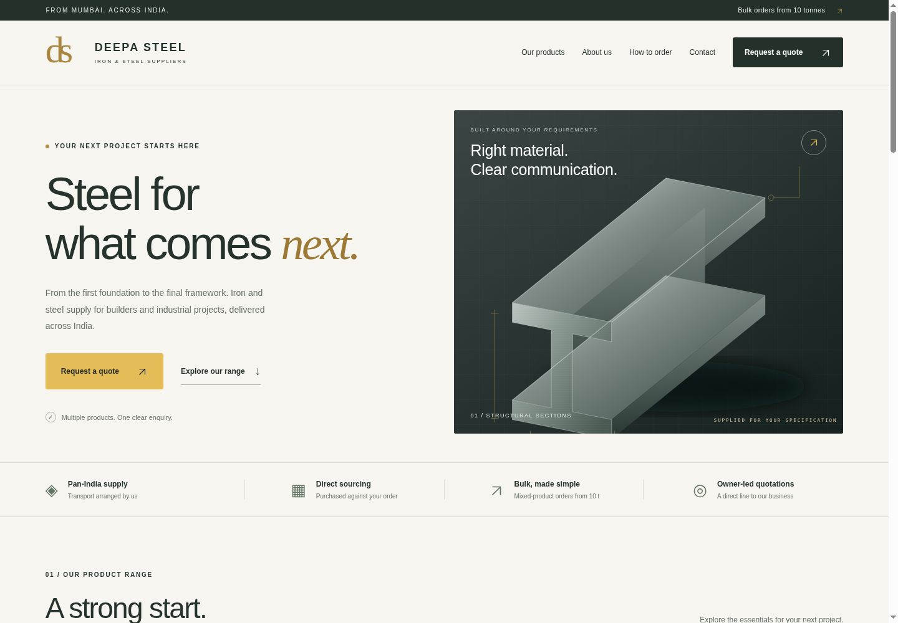
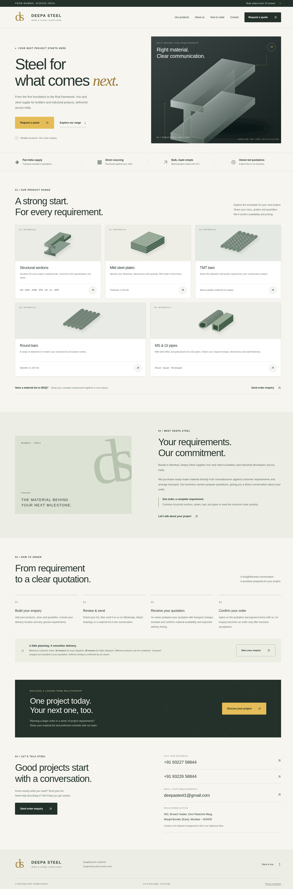

# Interactive website sample

[Download the interactive preview ZIP](preview/Deepa-Steel-Preview.zip) — download, extract, then open **Deepa-Steel-Preview.html** in Chrome or Edge on your laptop/desktop. No installation or deployment is needed. GitHub displays code for HTML files; download the file to try the actual website.

The full product catalogue, enquiry builder and review screen are included. Outgoing WhatsApp/email/call links are disabled in this review copy. Share the file with your dad for approval.

[Review and free-deployment instructions](preview/README.md)

[Production website ZIP, for deployment after approval](preview/Deepa-Steel-Website.zip)

---

# Deepa Steel — desktop design review

These are actual screenshots of the implemented website, captured in desktop Chromium. They are provided for design review before public deployment.

## Homepage

[Open the homepage image](screenshots/desktop-homepage.png)

## Complete page

[Open the full-page image](screenshots/desktop-full-page.png)

The screenshots show the catalogue, company information, ordering guidance and contact sections. This branch publishes the two images for review; it does not deploy the website.
## Updated business contacts

Business calling numbers: **9322758844** and **9322658844**, shown one below the other with no separate heading for the second number. WhatsApp enquiries go to **9322758844**.

[Desktop contact section](screenshots/contact-desktop.png) · [Mobile contact section](screenshots/contact-mobile.png)

## Quotation update

Transport charges are included in quotations. The interactive sample, production archive and screenshots reflect this clarification. Existing steel illustrations remain; web photographs are pending source access and licence verification.

## MS and GI pipes

The catalogue and enquiry form now include MS and GI pipe types. The sample still uses the existing illustrations: the five images supplied inline in chat are not yet available as downloadable project files. Their installation is pending original file attachments.
